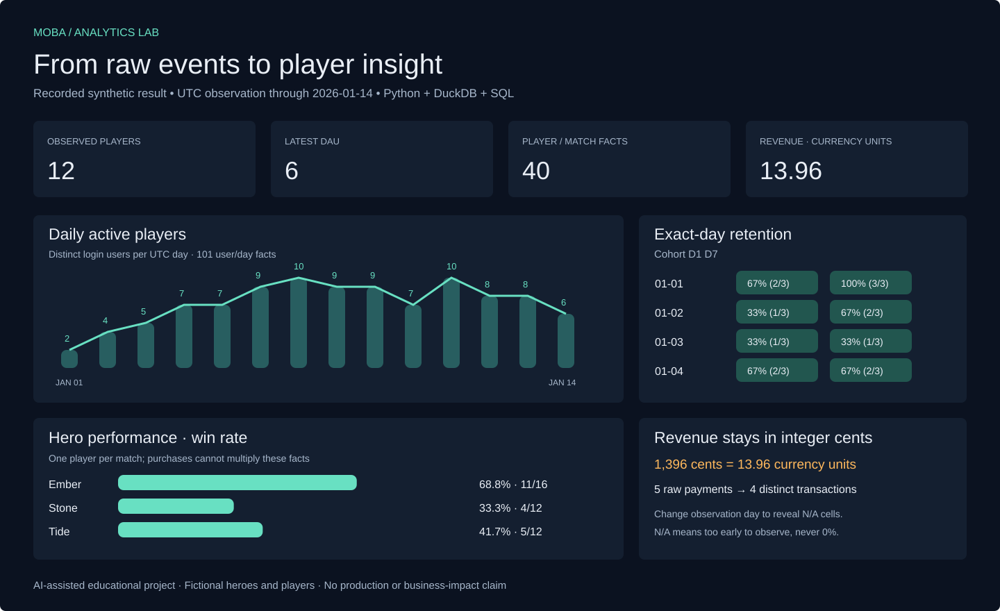

# MOBA Analytics Lab

[**Live demo →**](https://teddy8023mars.github.io/moba-analytics-lab/) · [Recorded data](docs/showcase-data.json) · [Visual preview](docs/assets/showcase.svg)

[](https://teddy8023mars.github.io/moba-analytics-lab/)

**What to click:** change the observation day to **2026-01-08** to see why newer D7 cohorts are **N/A**, then switch the hero measure between win rate, player matches, kills and assists. The dashboard is an offline-capable explorer of actual recorded synthetic pipeline results.

A runnable Python + DuckDB + SQL lab for reasoning about event identity, fact grains and cohort observation windows.

**All data is fully synthetic. This is an AI-assisted personal educational project, not an employer implementation, production system or measured business impact.** Hero names and player IDs are fictional.

## Run locally

Requires Python 3.11 or 3.12. No cloud account, API key, database server or dbt setup is needed.

```sh
python3 -m venv .venv
.venv/bin/python -m pip install -e .
.venv/bin/python -m unittest discover -s tests -v
.venv/bin/moba-lab generate --output examples/fixture.json --seed 7
.venv/bin/moba-lab run --input examples/fixture.json --as-of 2026-01-14 --output examples/report
```

Open `examples/report/index.html` in a browser. Six CSV tables and `run.json` accompany the HTML. The checked-in example was produced with these commands. Run metadata declares the UTC observation day; `--as-of` means the input is complete through that day's end, rather than merely the latest event date. The caller must guarantee that completeness. Future events are filtered out of analytical facts.

The seed-7 example has 12 users, 102 raw logins, 10 matches, 40 player/match rows and 5 raw payments. Exact repeats reduce these to 101 user/day rows and 4 payment transactions. These are tiny demonstration fixtures, not a throughput benchmark.

## Rebuild the visual showcase

```sh
PYTHONPATH=src .venv/bin/python scripts/build_showcase.py
PYTHONPATH=src .venv/bin/python -m unittest discover -s tests -v
```

Open `docs/index.html` directly, or serve `docs/` with a local static server. The standalone page embeds the exported data, uses no CDN or API, and works from a local file. `docs/showcase-data.json` records 14 actual pipeline runs against the same checked-in fixture. `docs/assets/showcase.svg` is a reproducible static preview. [Visual design and QA notes](docs/visual-design.md) explain chart semantics and acceptance checks.

## What the pipeline teaches

- Raw tables retain exact repeated events; staging removes repeats. Conflicting payloads for an identity fail rather than selecting an arbitrary row.
- UTC timestamps accept explicit offsets, then normalize to UTC. Naive timestamps, null keys, unknown references and events preceding signup fail explicitly.
- DAU and retention use a distinct login user/day fact. Repeated logins cannot inflate a retained-user count.
- D1/D7 are exact calendar-day retention. A cohort appears for an offset only when that offset is observable. A newer cohort is excluded, rather than treated as churn.
- Hero statistics use the player/match grain. A hero can have two appearances in one match, so player matches and distinct matches are separate measures. Payments are aggregated independently, preventing a player's multiple purchases from multiplying match facts.
- Currency amounts stay in integer cents. The fictional fixture assumes one currency; no currency conversion, refunds, taxes or net revenue are modeled.

## Structure

`src/moba_lab/models.sql` is the canonical, packaged SQL source. `pipeline.py` validates the table contract and executes it in an in-memory database. `fixtures.py` generates deterministic JSON records. `cli.py` exports CSV and escaped HTML. `tests/test_pipeline.py` uses independent hand-calculated fixtures rather than computing expected values with the implementation.

See [architecture](docs/architecture.md), [metric dictionary and input contract](docs/metrics.md), [actual verification](docs/verification.md), and [implementation plan](docs/implementation-plan.md).

## Scope

This release is a local full rebuild, with optional dbt and bounded Airflow examples described below. It provides no real telemetry connector, incremental warehouse load or production deployment. The validation checks event integrity, not full MOBA game rules: fixtures use four participants per match and do not model ranked rules or enforce balanced kill/death totals. Reports contain fictional metrics and establish no real business conclusions.

MIT licensed. Remote CI runs on Python 3.11/3.12, with separate optional integration jobs. See the repository's [actual workflow runs](https://github.com/teddy8023mars/moba-analytics-lab/actions/workflows/ci.yml) for commit-specific results.

## Role alignment

See [the current JD comparison](docs/jd-alignment.md) for which data engineering skills this lab demonstrates and which cloud, orchestration or distributed capabilities remain outside its scope.

## Optional executed dbt models

[Run and inspect the dbt walkthrough](docs/dbt.md). Thirteen dependency-linked SQL models rebuild all six marts from validated synthetic raw tables. Three singular data tests check fact keys, composite grains and retention/maturity invariants. The demo compares every mart against the original pipeline at two cutoffs, intentionally corrupts one retained count, observes dbt test exit 1, then rebuilds to restore exit 0. The original interactive Pages snapshot and metric definitions remain unchanged.

```bash
python3 -m venv .venv-dbt
.venv-dbt/bin/python -m pip install --index-url https://pypi.org/simple -r requirements-dbt.txt .
PYTHONPATH=src .venv-dbt/bin/python scripts/run_dbt_demo.py --output .dbt-output/demo-1
```

Use a fresh output folder: existing warehouse files are refused. Optional dependencies do not affect the core package. This is executed local dbt transformation and validation, without a scheduler, cloud warehouse or incremental dbt materialization.

## Measured local benchmark

[Reproduce the benchmark and read its limits](docs/benchmark.md). Three fresh-process samples at 2,150 / 21,500 / 107,500 synthetic raw rows record every wall-clock duration and whole-process peak RSS. All samples validate independent workload totals; the original pipeline/model definitions are unchanged. A separate actual query plan illustrates 60 raw login records collapsing to 56 user-days. This evidence measures local full rebuilds, without production capacity or optimization claims.

## Locate the measured bottleneck

[Stage profiling](docs/stage-profile.md) records three fresh-process samples each at 1,000 and 5,000 synthetic users. Raw-table preparation/loading takes about 99% of measured wall time in this regular workload; SQL models are a separate measured stage. Optional `--profile-stages` keeps metric results and default output unchanged. This locates a region to investigate before claiming an optimization.

## A measured loading change

[Read the interleaved loader experiment](docs/batched-load.md). On a regular 107,500-record synthetic workload, the full-pipeline median fell from 21.626 to 15.379 seconds across three fresh-process pairs (about 29% less elapsed time). All six complete metric outputs match the retained reference loader. Bounded 500-row parameter batches are now the default; reference executemany remains selectable. This is a local measured comparison, not a production throughput claim.

## Actual local Airflow execution

[Run the TaskFlow example](docs/airflow.md): generate synthetic data → build metrics → validate → write a local manifest. Real Airflow DAG.test runs show success, native retry after a transient failure, and bad metrics blocking downstream publication. Each scenario owns fresh local metadata/artifacts. This demonstrates local task dependency/retry execution, without claiming a scheduler or cloud deployment.

[Native Linux scheduler experiment](docs/scheduler.md) extends this with two scheduler-created `@once` runs of the canonical pipeline: clean metrics publish a verified local manifest; corrupt retention blocks publication. Actual Linux CI also checks timeout cleanup. This is a bounded SQLite/SequentialExecutor experiment; cloud deployment and ongoing uptime remain outside its scope.

### Verify local publication artifacts

[Read-only artifact verification](docs/artifact-verification.md) checks the local Airflow manifest against its metrics bytes, row counts and revenue before consumption. `moba-lab verify --manifest PATH` returns exit0 on consistency or exit2 on failure. Unsigned manifests provide no authentication; this adds no cloud deployment.

### Local partitioned Parquet exercise

[Write and query a user-day snapshot](docs/parquet.md): typed date partitions,
full readback and DAU reconciliation, plus an actual filter/projection query plan.
This optional local example adds no cloud deployment or performance claim.

### Optional S3 configuration, without deployment

[Terraform configuration and eight mocked plan checks](infra/s3-snapshot/README.md)
cover private storage settings and a prefix-scoped reader-policy document. Actual
validation and failure-mutation evidence is linked; no AWS resources were created.
