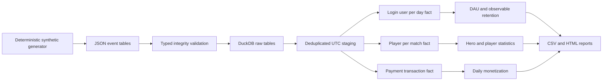

# Architecture

The entire rebuild runs in one in-memory DuckDB connection with timezone `UTC`. Raw events are validated before analytics execute, including conflicts even outside the observation window. SQL staging uses `DISTINCT` on typed exact duplicates. Input order does not decide which conflicting payload wins.

`user_day` is unique on `(activity_date, user_id)`. `fact_player_match` is unique on `(match_id, user_id)`, with one matching row in `stg_matches` per `match_id`. `stg_payments` is unique on `payment_id`. These fact sets never join each other. The analytical outputs cannot multiply match rows by transaction rows.

Report export is sequential and is not a transactional directory swap. Invalid input is rejected before export begins; an I/O failure during export can leave a partial directory. The database is discarded at the end of a run. This is deliberate scope for an educational first release.

The optional [Parquet exercise](parquet.md) persists the already-built user-day
fact to a fresh owned local Hive date-partition tree, verifies full readback and
DAU, and records a filtered plan. It does not change the canonical rebuild above
or make the original sequential HTML/CSV exporter transactional. A completion
summary identifies successful exercise runs; partial owned data can remain after
I/O failure, with no directory-transaction or cloud storage guarantee.
